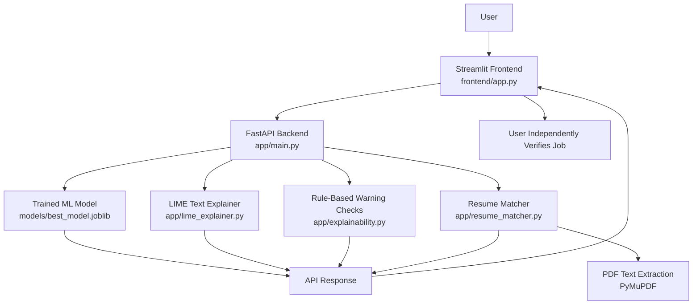

# Career Opportunity Checker

**Built by Team CareerGram**

Career Opportunity Checker is a learning project that helps users review job descriptions using a machine-learning prediction, text explanations, rule-based warning indicators, and optional resume-to-job skill matching.

> **Important:** This tool cannot confirm whether a job is genuine or fraudulent. Treat predictions and warning indicators as guidance only. Verify the employer and vacancy through official sources before paying fees or sharing personal information.

## Features

- Machine-learning prediction for a job description.
- LIME text explanation to show features that may influence a prediction.
- Rule-based warning indicators for selected suspicious patterns.
- Optional PDF resume parsing and skill matching against a job description.
- Streamlit user interface and FastAPI backend.
- Automated tests with Pytest.

## Interactive System Architecture

Explore the components by clicking each box, or use the filters to focus on the frontend, backend/model, or explanation tools:

**[Open the interactive system architecture](career_opportunity_checker_architecture.html)**

The interactive diagram is a separate HTML file because GitHub README pages do not run custom JavaScript or interactive widgets directly. Keep `career_opportunity_checker_architecture.html` in the same repository folder as this README for the relative link above to work.

### Static architecture diagram

GitHub can render the following Mermaid diagram directly in this README:



### Main components

| Component | Purpose | File / location |
|---|---|---|
| Frontend | Collects input and displays results | `frontend/app.py` |
| API backend | Receives requests and calls relevant modules | `app/main.py` |
| Trained model | Predicts from learned training patterns | `models/best_model.joblib` |
| LIME explainer | Explains influential text features locally | `app/lime_explainer.py` |
| Warning checks | Flags selected suspicious patterns | `app/explainability.py` |
| Resume matcher | Extracts resume text and compares skills | `app/resume_matcher.py` |

## Technology Stack

- Python
- FastAPI
- Streamlit
- scikit-learn and Joblib
- LIME
- PyMuPDF (`fitz`)
- Requests
- Pytest

## Project Structure

```text
CareerOpportunityChecker/
├── app/
│   ├── __init__.py
│   ├── main.py
│   ├── explainability.py
│   ├── lime_explainer.py
│   └── resume_matcher.py
├── frontend/
│   └── app.py
├── models/
│   └── best_model.joblib
├── tests/
│   ├── test_api.py
│   ├── test_explainability.py
│   ├── test_lime_explainer.py
│   └── test_resume_matcher.py
├── career_opportunity_checker_architecture.html
├── requirements.txt
└── README.md
```

The exact files in your local repository may differ as the project develops.

## Setup on Windows

Open Command Prompt or PowerShell in the project folder and run:

```powershell
python -m venv .venv
.venv\Scripts\activate
python -m pip install --upgrade pip
pip install -r requirements.txt
```

## Run the Application

Open two terminals in the project folder and activate the virtual environment in each terminal.

**Terminal 1 — Start the FastAPI backend:**

```powershell
uvicorn app.main:app --reload
```

API documentation should be available at `http://127.0.0.1:8000/docs`.

**Terminal 2 — Start the Streamlit frontend:**

```powershell
streamlit run frontend/app.py
```

## API Endpoints

| Method | Endpoint | Purpose |
|---|---|---|
| `GET` | `/` | Basic service route |
| `GET` | `/health` | Health check |
| `POST` | `/predict` | Predict using the trained model |
| `POST` | `/explain` | Return rule-based explanation indicators |
| `POST` | `/explain-model` | Return a LIME explanation |
| `POST` | `/resume-match` | Compare resume skills with job requirements |

Check `app/main.py` for the exact request and response formats.

## Run Tests

From the project root, with the virtual environment activated:

```powershell
python -m pytest -q
```

To run only the LIME tests:

```powershell
python -m pytest tests/test_lime_explainer.py -q
```

## Understanding the Results

- A model prediction reflects patterns learned from its training dataset; it can be wrong on new or unusual job descriptions.
- LIME provides a local approximation of how text features may affect a model prediction. Its weights are not proof of fraud and are not fraud probabilities.
- Rule-based checks flag patterns selected by the developer. A flagged phrase may appear in a legitimate vacancy, and a fraudulent vacancy may avoid these phrases.
- Resume matching compares extracted skills; it does not predict whether an employer will shortlist or hire a candidate.

## Limitations and Future Improvements

- Evaluate the model on a representative, independently labelled dataset.
- Report appropriate evaluation metrics and check for data leakage.
- Improve skill synonym matching and PDF extraction robustness.
- Add clearer evidence and official employer verification steps.
- Improve accessibility, input validation, and API error handling.

## Community

Follow or share the Team CareerGram WhatsApp channel:

[Join the CareerGram WhatsApp Channel](https://whatsapp.com/channel/0029VbARpEB7T8bYWCeDN61H)

## Responsible Use

Do not rely on this tool alone when deciding whether to accept a job, pay money, or share identity or banking information. Verify the opportunity using independently found official contact details.

---

**Built by Team CareerGram**
